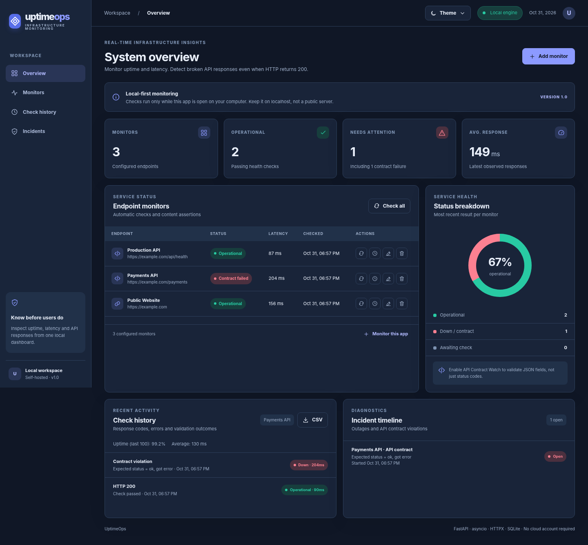

# UptimeOps - local-first uptime and API contract monitoring

A self-hosted **Python/FastAPI monitoring dashboard** for websites and HTTP APIs. This is a **personal portfolio project**, separate from the CodeAtlas university assignment.



## Why UptimeOps?

A `200 OK` HTTP response does not always mean an API is healthy. A server may reply with `{ "status": "error" }` while returning HTTP 200. **API Contract Watch** lets you configure simple JSON assertions, so UptimeOps records those responses as failures and opens an incident.

UptimeOps is an application, not a cloud monitoring service. Checks run **while the process is running**, on your own computer, and results remain in SQLite. No cloud account or paid API key is required.

## Features

- **Unified monitoring dashboard**: active monitors, status, response time, total checks and health breakdown.
- **Scheduled asynchronous checks**: configurable intervals of 30 seconds to 24 hours; bounded concurrency and HTTP timeouts.
- **API Contract Watch**: validate a JSON field (including nested fields/array indexes), with `equals`, `not_equals`, `exists`, `gte` and `lte` rules.
- **Incident lifecycle**: first failed check opens an incident; subsequent failures continue it; a successful check resolves it.
- **Monitor management**: create, edit, delete, manually check, and inspect history.
- **Persisted data and migration**: SQLite stores monitor definitions, checks and incidents; older preview databases are upgraded automatically.
- **Uptime statistics**: sample-based uptime and average latency for the most recent 100 checks.
- **CSV export**: download the latest 500 historical checks for a monitor.
- **Five color themes**: Indigo, Ocean, Forest, Sunset and Night; theme persists in the browser.
- **Responsive interface**: built-in SVG icon set (no font/CDN dependence), desktop and mobile layouts.
- **Tests and CI**: pytest tests and GitHub Actions workflow.

### Example: API Contract Watch

Endpoint response, HTTP `200 OK`:

```json
{"status":"error", "database":"disconnected"}
```

Monitor configuration: JSON path `status`, comparison `equals`, expected `ok`.

**Result:** `Contract failed` despite HTTP 200. An incident is recorded with the mismatch reason. Once the API returns `{ "status": "ok" }`, the incident closes automatically.

This is a portfolio demonstration of a known monitoring technique, **not a claim that JSON response assertions are new to the industry**.

## Quick start (Windows)

Install **Python 3.11 or newer** (Python 3.13 works). Then:

1. Extract the ZIP file.
2. Double-click **`RUN_ME_WINDOWS.bat`** in the project root.
3. Wait for dependency installation and server startup.
4. Open **http://127.0.0.1:8002**.
5. Click **Monitor this app** (checks the app's own `/api/health`, including a JSON contract assertion).
6. Add another endpoint with **Add monitor**, and enable **API Contract Watch** for a JSON endpoint if desired.

The initial dependency installation requires an internet connection. Keep the terminal window open while monitoring; close it with `Ctrl+C`.

### Manual run (Windows PowerShell)

```powershell
py -3 -m venv .venv
.\.venv\Scripts\python.exe -m pip install -r requirements.txt
$env:PYTHONPATH = 'src'
.\.venv\Scripts\python.exe -m uvicorn uptimeops.api:app --host 127.0.0.1 --port 8002
```

### Linux / macOS

```bash
python3 -m venv .venv
.venv/bin/python -m pip install -r requirements.txt
PYTHONPATH=src .venv/bin/python -m uvicorn uptimeops.api:app --host 127.0.0.1 --port 8002
```

### Local Docker option

```bash
docker compose up --build
```

Open `http://127.0.0.1:8002`. The Docker Compose port is bound to loopback. **Note:** the built-in self-check's `127.0.0.1` target refers to the container itself; the app works for that target inside the container, while host-only endpoints may not be accessible.

## Tests

```bash
python -m pytest -q
```

Windows: run **`RUN_TESTS_WINDOWS.bat`** after installing dependencies. Automated tests use mock HTTP requests, temporary databases and FastAPI's test client. They do not call external websites.

## Tech stack

| Layer | Technology |
|---|---|
| Backend / HTTP API | Python, FastAPI, Pydantic |
| Probes / scheduler | HTTPX, asyncio |
| Storage | SQLite (parameterized SQL statements) |
| Dashboard | HTML, CSS, vanilla JavaScript, inline SVG |
| Testing | pytest, FastAPI TestClient, HTTPX MockTransport |
| CI | GitHub Actions |

## Architecture

```text
Browser UI
    │ HTTP + JSON
    ▼
FastAPI (api.py) ──→ SQLite Store (storage.py)
    │                     ├─ monitors
    │                     ├─ checks
    └─ asyncio scheduler  └─ incidents
          │
          ▼
     HTTPX probe (monitor.py)
          │
          ▼
     JSON assertions (contracts.py)
```

See [docs/ARCHITECTURE.md](docs/ARCHITECTURE.md) and [docs/SECURITY.md](docs/SECURITY.md).

## API endpoints

| Method | Route | Description |
|---|---|---|
| GET | `/api/health` | Self-test |
| GET/POST | `/api/monitors` | List / create monitors |
| PUT/DELETE | `/api/monitors/{id}` | Edit / delete monitor |
| POST | `/api/monitors/{id}/check` | Run an immediate probe |
| GET | `/api/monitors/{id}/checks` | Recorded checks |
| GET | `/api/monitors/{id}/stats` | Recent uptime and latency |
| GET | `/api/monitors/{id}/export.csv` | CSV download |
| GET | `/api/incidents` | Most recent incidents |
| GET | `/api/summary` | Dashboard summary |

Open **http://127.0.0.1:8002/docs** for auto-generated OpenAPI documentation.

## Limitations and security

- **Local/trusted single-user deployment only.** The service has no authentication, account boundaries, CSRF defense or production-grade network isolation. **Do not make it accessible from the public Internet or bind directly to `0.0.0.0` on the host.**
- Incoming endpoint URLs have a public-address restriction, with one special local demo URL. DNS rebinding and other network edge cases remain possible; these restrictions are **not a complete SSRF defense**.
- In-process scheduling runs while the app process runs; this isn't a distributed, always-on alerting service. There are **no email/Telegram notifications** yet.
- Uptime percentage reflects **the most recent 100 checks**, not an SLA or continuous-time uptime measurement.
- Up to 500 most recent check records can be exported per request; large datasets need pagination/retention management.
- One JSON assertion per monitor, with simple dotted paths; advanced JSONPath/schema checks are not implemented.
- Editing a monitor resets its latest status to Pending; older historical check records remain available.

## Development notes

- [CHANGELOG.md](CHANGELOG.md) lists actual release improvements.
- [docs/QUICKSTART_RU.md](docs/QUICKSTART_RU.md) contains Windows setup and testing steps in Russian.
- Source includes no API keys, passwords or connection secrets.
- AI assistance: ChatGPT contributed substantial portions of implementation, tests, documentation and UI. This contribution should be disclosed accurately in portfolio discussions; review and understand the code, and make real incremental commits rather than fabricating Git history.

**License:** MIT. Before publishing on GitHub, replace the project author information in your GitHub profile and verify that the license choice fits your goals.
